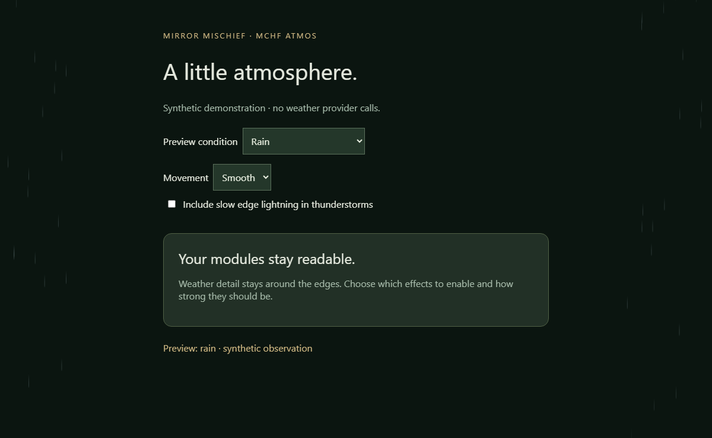

# Mischief Atmos · MMM-MCHF-Atmos

Subtle snow, crystalline frost, rain, heat shimmer and optional edge lightning driven by fresh **current weather**, drawn locally around the edges of your mirror. **MCHF means Mischief.**

Part of [Mirror Mischief](https://github.com/FoggEyez/Mirror-Mischief). The companion is optional; its public installer is not released yet.



## Install manually

Requires MagicMirror² 2.38.0 or newer, Node.js 22 or newer and a current browser. No npm runtime dependencies, paid accounts, video assets, VideoGen or OpenArt.

```sh
cd ~/MagicMirror/modules
git clone https://github.com/FoggEyez/MMM-MCHF-Atmos.git
```

Add this to your `config/config.js` modules array:

```js
{
  module: 'MMM-MCHF-Atmos',
  position: 'fullscreen_above',
  config: { source: 'magicmirror', intensity: 45, lightning: false }
}
```

With `source: 'magicmirror'`, Atmos listens to the built-in weather module's `WEATHER_UPDATED` notification. That weather module must be configured as `type: 'current'`. Units must be metric or imperial; optional `weatherInstance` selects its instance identifier. Forecasts and notifications with missing observation dates are not used. This mode adds no provider calls or location transmission beyond your existing weather configuration.

Alternatively use `source: 'open-meteo'`, `locationConfigured: true`, `latitude: YOUR_LATITUDE` and `longitude: YOUR_LONGITUDE` (replace these placeholders with numbers). Atmos then requests current temperature and WMO weather code from the [Open-Meteo forecast API](https://open-meteo.com/en/docs), normally every 10 minutes. No API key is required for its public non-commercial endpoint; provider terms and availability apply. Coordinates are sent to Open-Meteo. The source is fixed HTTPS, without credentials or arbitrary URL execution.

## Customize

All options are literal defaults for companion settings discovery:

| Option | Default | Meaning |
| --- | --- | --- |
| source | magicmirror | magicmirror or open-meteo |
| locationConfigured | false | Explicitly enable direct provider requests after setting coordinates |
| latitude / longitude | 0 / 0 | Your location; ignored in magicmirror mode |
| weatherInstance | empty | Optional native weather instance identifier |
| maxAgeSeconds | 1800 | Stale-data limit; clamped to 300–7200 |
| pollSeconds | 600 | Direct provider interval; clamped to 300–3600 |
| intensity | 45 | 0–100 visual opacity |
| motion | auto | auto, gentle or still; system reduced-motion preferences take priority |
| showSnow / showFrost / showRain / showHeat / showThunder | true | Enable individual conditions |
| lightning | false | Slow, narrow edge lightning with thunderstorms; never full-screen flashes or audio |
| frostBelowC | 0 | Freezing-air visual threshold, −10 to 5°C; does not prove frost on the ground |
| heatAboveC | 35 | Hot-air visual threshold, 25–50°C; a single reading does not establish a meteorological heatwave |
| edgeWidth | 12 | Effect band width, 4–30% of the screen |
| clearZones | [] | Optional rectangles `{x,y,width,height}` in screen percentages to keep clear |

Thunder takes precedence over snow, rain, frost and heat. Stale, missing or future observations remove the atmosphere; clear weather shows no effect. Precipitation and snow particles remain in the edge bands. There is no sound. Still mode keeps only stationary edge artwork; rain particles disappear rather than pretending to be motionless rain.

## Preview and companion

After installation open `/modules/MMM-MCHF-Atmos/preview.html` on your normal MagicMirror² address for a clearly labelled synthetic preview, or open that file locally. It makes no provider requests. Module settings in the companion expose the same source, visibility, thresholds, intensity and motion fields.

Use `animateIn: 'fadeIn'` at the module-entry level if desired. As a full-screen atmosphere layer, Atmos keeps a transparent background; earthy card surfaces are for information modules.

## Validation, credits and support

Original Mischief procedural artwork and rendering; MIT. Tests cover conditions, stale/future data, temperature units and provider-code parsing. Preview values are synthetic; physical-device frame rate and independent installation remain to be verified. One instance per mirror is supported. No analytics or personal data collection is added.

Run `npm ci` and `npm test`. Report bugs with your platform, MagicMirror version and minimal configuration with private information removed. Review releases, back up private config and use `git pull --ff-only` before restarting to update. Disable/remove the config entry to stop the module.

## Help and troubleshooting

See [TROUBLESHOOTING.md](TROUBLESHOOTING.md) for common states and setup checks. [Open an issue](https://github.com/FoggEyez/MMM-MCHF-Atmos/issues) with a minimal configuration that has secrets removed.
